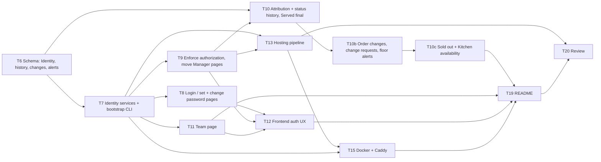

# Plan: Production readiness for TableIt
Status: draft
Version: 4

## Goal
TableIt is built to production standard as a portfolio project for one restaurant per installation. Every staff member signs in with their own account (a username given by a Manager and a password they choose themselves) and has one role: Floor, Kitchen or Manager. Each order records who took it and everything that happened to it. Floor staff can change an order until the kitchen has finished it: changes to a New order apply at once, and changes to an In progress order are change requests that the Kitchen approves or denies. The Kitchen marks items sold out for the rest of the service day without a Manager, and Floor staff get shared floor alerts when a guest has to be told something. Data survives upgrades through EF Core migrations, and the app ships as a Docker + Caddy deployment with HTTPS, health checks, logs and CI.

The domain terms used here (Floor, Kitchen, Manager, staff member, Team, guest, order change, change request, sold out, off the menu, floor alert, service day) are defined in `CONTEXT.md`.

## Decisions
User answers to the Version 1 open questions:
1. **Hosting: on-prem.** A mini PC or NAS in the restaurant, running Docker on the LAN behind Caddy for HTTPS.
2. **Sign-in: individual staff accounts** with ASP.NET Core Identity, not shared PINs. Each order records who took it.
3. **One restaurant per installation.** No multi-tenancy.
4. **No payments.** Orders only; billing stays on the existing till, so prices stay as they are (`decimal`).
5. **Status transitions: forward flow plus one-step undo, except that Served is final** (amended in Version 4, Decision 15). Implemented in T2; T10 removes Served → Ready.
6. **Note retention:** clear `Order.Note` and `OrderLine.Note` on orders older than a configurable 30 days. Deferred to the backlog in Version 4 (Decision 11).
7. **Database: keep SQLite.** WAL mode is already on (T4).

User answers to the Version 2 open questions:
8. **Login screen: a plain username + password form.** No name picker and no PIN. A Manager creates each account (username, display name, role). The staff member chooses their own password, and the Manager never knows it.
   - Creating an account (or resetting a password) gives the Manager a one-time setup code to hand over. The code is single use, valid for 24 hours, and shown once.
   - The staff member enters their username, the code and a new password on a "Set your password" page.
   - "Reset password" issues a new setup code and signs the user out everywhere.
   - Signed-in staff members can change their own password.
9. **Devices: mostly personal phones.** 12-hour sliding session, a manual "Switch user", and idle sign-out off by default (`Auth:IdleSignOutMinutes`, default 0, kept as an optional setting).
10. **Minimum password length: 8 characters.** Any characters, no composition rules, configurable through `Auth:MinPasswordLength` (default 8). The lockout (5 tries, then 5 minutes) and the per-IP login rate limit stay.

User answers from the Version 3 review:

11. **This is a portfolio build; there is no pilot restaurant yet.** Backups, note retention, floor plan concurrency, frontend resilience, browser E2E tests and the operations runbook move to the backlog. Order changes are added instead.
12. **Backups on the same box are an accepted risk.** Order history may be lost; billing stays on the till. Off-box backups go with T14 in the backlog.
13. **HTTPS: a real domain with a DNS challenge by default**, so staff do not have to trust a private root CA on their personal phones. `tls internal` stays as the fallback for setups without a domain.
14. **Roles are Floor, Kitchen and Manager.** "Staff member" means any account (`StaffUser` in code). The Manager's admin page is `/Manager/Team`. The menu editor and floor planner move to `/Manager/Menu` and `/Manager/Planner`.
15. **Served is final.** Served → Ready is removed. The Kitchen keeps its other undo steps (Ready → In progress, In progress → New) and can still cancel a Ready order.
16. **Order changes.** Any Floor staff member can change any order's lines, line notes and order note, or cancel it.
    - New: the change applies immediately.
    - In progress: the change becomes a change request that the Kitchen approves or denies.
    - Ready, Served or Cancelled: no changes. Floor places a new order instead.
    - The server decides by the order's status when the change is saved. If it turned In progress in the meantime, the waiter sees "The kitchen has started this order; your change was sent for approval."
    - Cancelling is an order change that removes everything, so it follows the same rules. The Kitchen can still cancel directly.
17. **Change requests.**
    - At most one pending change request per order. Sending another replaces it.
    - The order cannot move to Ready while a change request is pending.
    - The staff member who sent it can withdraw it until the Kitchen decides.
    - The Kitchen can deny with an optional one-tap reason ("Already cooked", "Sold out", or free text).
    - On approval, the sender gets a quiet toast. A denial raises a floor alert.
18. **Sold out and off the menu are separate.**
    - **Sold out:** the Kitchen sets it, and it clears by itself when the next service day starts.
    - **Off the menu:** a Manager sets it, and it stays until a Manager puts the item back.
    - Either one blocks adding the item to an order or an order change. Neither one changes existing orders.
    - Each New order that already contains the item gets a floor alert, and its kitchen card shows a sold-out warning until the item is removed.
19. **Floor alerts.**
    - Raised when a change request is denied, and when an item in a New order is marked sold out.
    - Shown to every Floor staff member.
    - One "Guest told" tap clears the alert for everyone. It has a "Change order" shortcut.
    - The existing "order ready" toast and table badge stay as they are and are not floor alerts.
20. **Order history is stored in one `OrderEvents` table, and pending proposals in `ChangeRequests`.** See `docs/adr/0001-order-events-and-change-requests.md`.

## Assumptions
- **Base branch.** T1–T5 are done (PR #8, merged). T6 onwards branch from main.
- **Baseline.** Build and test with `dotnet build TableIt.sln` and `dotnet test TableIt.sln`. CI (`.github/workflows/ci.yml`) runs the same commands. EF tooling comes from the local tool manifest (`.config/dotnet-tools.json`): `dotnet tool restore && dotnet ef ...`. There is no separate linter, so build warnings count as lint.
- **Identity fits the current DbContext:**
  - `TableItDbContext` derives from plain `DbContext` and its `OnModelCreating` does not call `base`. Switching it to `IdentityDbContext<StaffUser, IdentityRole, string>` only requires adding `base.OnModelCreating(modelBuilder)` as the first line.
  - The table names `Tables`, `MenuItems`, `Orders` and `OrderLines` do not clash with the `AspNet*` Identity tables.
  - The UTC converter is configured per property, so it does not affect Identity's `DateTimeOffset LockoutEnd`.
  - The constructor signature stays the same, so `TestDb` and `TableItFactory` keep working.
  - `MigrationTests.Migrate_OnEmptyFile_CreatesSchemaMatchingTheModel` will catch a forgotten migration.
  - New package needed: `Microsoft.AspNetCore.Identity.EntityFrameworkCore` 8.0.*.
- **Sign-in design** (Decisions 8–10):
  - **Credentials.** Identity username and password. The password policy is length at least `Auth:MinPasswordLength` (default 8), with no digit, case, symbol or unique-character requirements.
  - **Lockout.** Identity lockout after 5 failed attempts for 5 minutes, plus a per-IP rate limit on the login and set-password POSTs.
  - **Cookie.** HttpOnly, SameSite=Strict, Secure, 12-hour sliding expiry.
  - **Fast revocation.** `SecurityStampValidatorOptions.ValidationInterval` of 1 minute, so deactivating a user or resetting their password signs them out everywhere within a minute.
  - **Shared devices.** A prominent "Switch user" action signs out and opens the login form. Optional idle sign-out via `Auth:IdleSignOutMinutes` (default 0, which means off).
  - **Kitchen screen.** The kitchen display can be signed in as an ordinary Kitchen-role account for the whole night. Status changes and change request decisions are then attributed to that account, which is acceptable.
- **Setup codes need no new table.**
  - A user created by a Manager has no password (`PasswordHash` is null), so the user cannot sign in until the code is redeemed.
  - `SetupCodeService` (T7) generates a random 8-character code from an unambiguous alphabet, formatted like `K7QM-4TXR` (about 40 bits).
  - It stores only a SHA-256 hash and the expiry time, as an Identity user token: `SetAuthenticationTokenAsync(user, "TableIt", "SetupCode", "<hash>|<expiresUtc>")`, in the `AspNetUserTokens` table that T6's migration creates.
  - Redeeming checks the hash (constant-time comparison) and the expiry, then sets the password with `AddPasswordAsync`, removes the token (single use) and updates the security stamp.
  - Failed redemptions count toward lockout (`AccessFailedAsync`), and the page is rate-limited.
  - Issuing a new code replaces the old one.
  - Resetting a password calls `RemovePasswordAsync`, issues a new code and updates the security stamp.
  - Identity's built-in reset tokens were considered and not used. `DataProtectorTokenProvider` tokens are too long to read out or type, and the TOTP providers only last minutes.
- **Bootstrapping the first Manager:** a CLI command, `dotnet TableItWeb.dll create-manager --username <name> --display-name "<name>"` (in Docker: `docker compose run --rm app create-manager ...`).
  - It prompts for the Manager's password twice (masked on a TTY; piped stdin is also accepted for scripting). No setup code is involved.
  - It refuses to run if an active Manager already exists, unless `--reset-password` is given (`--reset-password` is the lock-out recovery path).
  - There is no hard-coded default password outside the Development seed.
  - In Development only, when `Seed:DemoData=true`, demo users with the documented dev-only password `tableit-dev` are seeded.
- **Role matrix** (Manager implies the other two roles):
  - **Floor:**
    - read orders, tables, menu and floor alerts
    - place orders
    - make order changes and withdraw their own change requests
    - acknowledge floor alerts
    - set status Ready → Served, and New → Cancelled (cancelling an In progress order goes through a change request)
  - **Kitchen:**
    - read orders and menu
    - any allowed status transition
    - approve or deny change requests
    - mark items sold out or back in
    - the `/Kitchen` and `/Kitchen/Availability` pages
  - **Manager:**
    - menu writes, including off the menu
    - the floor plan and Team management
    - `/Manager/Menu`, `/Manager/Planner` and `/Manager/Team`
- **Status transitions after Version 4.**
  - New → In progress or Cancelled.
  - In progress → Ready, New or Cancelled. In progress → Ready is refused (409) while a change request is pending.
  - Ready → Served, In progress or Cancelled.
  - Served and Cancelled are final.
- **Order changes use replace semantics.**
  - A change sends the full desired list of lines plus the order note. Each line is either an existing line (`lineId`, keeping its name and price snapshot) or a new one (`menuItemId`, taking the current name and price).
  - Sending zero lines with `cancel: true` cancels the order.
  - New lines are rejected if their menu item is sold out or off the menu. Lines already on the order are allowed either way.
  - Each change carries a `ClientRequestId`, so a retry cannot apply it twice.
  - The status check and the write happen in one transaction, so a concurrent New → In progress makes the change a change request instead of applying it.
- **Sold out without a background job.** `MenuItem.SoldOutAt` (UTC, nullable) is set when the Kitchen marks an item sold out. An item counts as sold out while `SoldOutAt >= ServiceDay.StartUtc(now)`, so it clears by itself at the next service day. The existing `IsAvailable` flag keeps its column and JSON name but means "on the menu" (false = off the menu), and only a Manager changes it.
- **Floor alerts** live in a `FloorAlerts` table (OrderId, Kind, Message, CreatedAt, AcknowledgedByUserId, AcknowledgedByName, AcknowledgedAt).
  - Unacknowledged alerts from the current service day are loaded with the page, and arrive live as the SignalR events `FloorAlertRaised` and `FloorAlertCleared`.
  - Acknowledging is idempotent, and the first acknowledgement wins.
  - Each raise and each acknowledgement is also written to `OrderEvents`.
- **Attribution and history.**
  - Orders get `CreatedByUserId` (string, nullable for older orders) and `CreatedByName` (a snapshot of the display name), in the same way `TableNumber` and line names are snapshotted.
  - Everything else that happens to an order is a row in `OrderEvents` (OrderId, Kind, From?, To?, Detail?, UserId?, UserName?, At).
    - Kinds: StatusChanged, Changed, ChangeRequested, ChangeApproved, ChangeDenied, ChangeWithdrawn, AlertRaised and AlertAcknowledged.
  - Staff accounts are deactivated, never deleted, so these references and names stay valid.
- **Migrations.** T6 creates every schema change for this version in one migration. Any later schema change must add its own migration, and tasks that touch `Migrations/` never share a wave.
- **README.** Only T19 edits `README.md`.
- **Backlog, out of scope for this plan:**
  - Bills and payments, guest self-ordering, reservations, multiple floors, kitchen printers, Danish UI translation, end-of-day reports, PWA install, and a UI for browsing the order history (the data is recorded now).
  - Moving an order to another table.
  - Version 3 tasks moved out by Decision 11:
    - T14: nightly SQLite backups (with an off-box copy) and 30-day note clearing
    - T16: floor plan optimistic concurrency and the `DeferModelErrors` cleanup
    - T17: frontend resilience (draft persistence, offline retry, the T2 edited-retry edge case, wake lock)
    - T18: Playwright E2E tests
    - the `docs/operations.md` runbook from T19
  - Their full Version 3 specs are in git history (commit bcb9a52).

## Open questions
None.

## Tasks
### T1: Input validation and limits on the API (must-have)
- [x] Done (PR #8)
- Delivered:
  - DataAnnotations limits on menu, table and order payloads, and `[MaxLength]` on entity strings.
  - Removing a table with open orders is rejected.
  - Deviation: a `DeferModelErrors` filter in `TablesController` keeps two older plain-text 400 responses (cleanup is in the backlog with T16).

### T2: Order status rules and idempotent order placement (must-have)
- [x] Done (PR #8)
- Delivered:
  - The Decision 5 transition table; illegal transitions return 409. (T10 removes Served → Ready.)
  - `ClientRequestId` on `CreateOrderRequest` and `Order`, with a unique index. A repeat returns the existing order with 200, a new order returns 201, and `staff.js` sends one ID per draft.
  - Known edge case, now in the backlog with T17: if a send that timed out actually succeeded and the draft is then edited, the retry returns the original order and the edit is silently lost.

### T3: Configurable restaurant time zone and service day start (must-have)
- [x] Done (PR #8)
- Delivered:
  - `ServiceDay.StartUtc(TimeZoneInfo, startHour)` and `ServiceDay.Resolve(IConfiguration)`, reading `Restaurant:TimeZone` and `Restaurant:ServiceDayStartHour`.
  - Deviation: an invalid zone or hour only fails at the first request. A startup check is added in T13.

### T4: EF Core migrations, database configuration and seeding policy (must-have)
- [x] Done (PR #8)
- Delivered:
  - The `InitialCreate` migration with `Database.Migrate()` on startup.
  - The `Seed:DemoData` switch (true only in Development).
  - WAL mode and `Default Timeout=5`, the `Restaurant` config section, a local `dotnet-ef` tool manifest, and `MigrationTests`.

### T5: CI pipeline (must-have)
- [x] Done (PR #8)
- Delivered: `.github/workflows/ci.yml` builds and tests on pushes and PRs to main.

### T6: Identity, attribution, order history, change requests and floor alerts data model, with migration (must-have)
- [ ] Not done
- Agent: implementer
- Depends on: none (T1–T5 are done)
- Files:
  - src/TableItWeb/TableItWeb.csproj
  - src/TableItWeb/Data/StaffUser.cs (new)
  - src/TableItWeb/Data/TableItDbContext.cs
  - src/TableItShared/Models/Order.cs
  - src/TableItShared/Models/MenuItem.cs
  - src/TableItShared/Models/OrderEvent.cs (new)
  - src/TableItShared/Models/ChangeRequest.cs (new)
  - src/TableItShared/Models/FloorAlert.cs (new)
  - src/TableItWeb/Data/Migrations/* (new migration plus snapshot)
  - tests/TableItWeb.Tests/Controllers/MigrationTests.cs
  - tests/TableItWeb.Tests/Data/SchemaTests.cs (new)
- Do:
  - Add `Microsoft.AspNetCore.Identity.EntityFrameworkCore` 8.0.*.
  - Add `StaffUser : IdentityUser` with `DisplayName` (required, at most 100 characters), `IsActive` (default true) and `CreatedAt`.
  - Change `TableItDbContext` to `IdentityDbContext<StaffUser, IdentityRole, string>` and call `base.OnModelCreating(modelBuilder)` first.
  - Add `Order.CreatedByUserId` (string?, at most 450) and `Order.CreatedByName` (string?, at most 100).
  - Add `MenuItem.SoldOutAt` (DateTime?, UTC using the existing converter pattern). Keep `IsAvailable` unchanged, and document it in an XML comment as "on the menu; false means off the menu".
  - Add `OrderEvent`:
    - Columns: Id; OrderId (FK, cascade delete); `Kind` (string-converted enum: StatusChanged, Changed, ChangeRequested, ChangeApproved, ChangeDenied, ChangeWithdrawn, AlertRaised, AlertAcknowledged); `From?` and `To?` (string-converted `OrderStatus`); `Detail?` (at most 500); `UserId?`; `UserName?` (at most 100); `At` (UTC).
    - Indexed on OrderId.
  - Add `ChangeRequest`:
    - Columns: Id; OrderId (FK, cascade delete); `Status` (string-converted enum: Pending, Approved, Denied or Withdrawn); `IsCancel`; `Note?` (at most 500, the proposed order note); `ClientRequestId` (unique); `RequestedByUserId?` and `RequestedByName?`; `RequestedAt`; `DecidedByUserId?` and `DecidedByName?`; `DecidedAt?`; `Reason?` (at most 200).
    - Child rows `ChangeRequestLine`: Id, ChangeRequestId (FK, cascade delete), `SourceLineId?`, MenuItemId, Name, UnitPrice, Quantity, `Note?`.
    - Indexed on (OrderId, Status).
  - Add `FloorAlert`:
    - Columns: Id; OrderId (FK, cascade delete); `Kind` (string-converted enum: ChangeDenied, ItemSoldOut); `Message` (at most 200); `CreatedAt`; `AcknowledgedByUserId?`; `AcknowledgedByName?`; `AcknowledgedAt?`.
    - Indexed on AcknowledgedAt.
  - Add the `DbSet`s `OrderEvents`, `ChangeRequests` and `FloorAlerts`.
  - Create the migration `AddIdentityHistoryAndOrderChanges` with `dotnet tool restore && dotnet ef migrations add AddIdentityHistoryAndOrderChanges --project src/TableItWeb --output-dir Data/Migrations`.
  - No service wiring and no controller changes.
- Done when:
  - The migration applies cleanly on top of `InitialCreate`, both on an empty DB and on a DB that already has orders (old orders get null attribution, and menu items get a null `SoldOutAt`).
  - `MigrationTests` still reports no pending model changes, and all existing tests pass.
- Verify: `dotnet test TableIt.sln && dotnet tool restore && dotnet ef migrations has-pending-model-changes --project src/TableItWeb`

### T7: Identity services, cookie auth, roles, setup codes and Manager bootstrap command (must-have)
- [ ] Not done
- Agent: implementer
- Depends on: T6
- Files:
  - src/TableItWeb/Program.cs
  - src/TableItWeb/Auth/AuthSetup.cs (new; `AddTableItAuth` extension)
  - src/TableItWeb/Auth/Roles.cs (new; role names and policy names)
  - src/TableItWeb/Auth/StaffSignInManager.cs (new)
  - src/TableItWeb/Auth/StaffClaimsFactory.cs (new)
  - src/TableItWeb/Auth/RoleSeeder.cs (new)
  - src/TableItWeb/Auth/SetupCodeService.cs (new)
  - src/TableItWeb/Auth/CreateManagerCommand.cs (new)
  - src/TableItWeb/Data/SeedData.cs
  - src/TableItWeb/appsettings.json
  - src/TableItWeb/appsettings.Development.json
  - tests/TableItWeb.Tests/Auth/AuthSetupTests.cs (new)
  - tests/TableItWeb.Tests/Auth/SetupCodeServiceTests.cs (new)
  - tests/TableItWeb.Tests/Auth/CreateManagerCommandTests.cs (new)
- Do:
  - Register `AddIdentity<StaffUser, IdentityRole>().AddEntityFrameworkStores<TableItDbContext>().AddDefaultTokenProviders()`.
  - Password policy: `RequiredLength = Auth:MinPasswordLength` (default 8), `RequireDigit`, `RequireLowercase`, `RequireUppercase` and `RequireNonAlphanumeric` all false, `RequiredUniqueChars = 1`. Lockout after 5 failed attempts for 5 minutes, also enabled for new users. Unique usernames.
  - `StaffSignInManager.CanSignInAsync` returns false when `IsActive` is false.
  - `StaffClaimsFactory` adds a `display_name` claim.
  - Application cookie:
    - Login path `/Account/Login` and access-denied path `/Account/AccessDenied`.
    - HttpOnly, SameSite=Strict, Secure policy `SameAsRequest` (TLS is terminated at Caddy; T13 adds forwarded headers).
    - 12-hour sliding expiry, configurable through `Auth:SessionHours`.
    - For requests under `/api` or `/hubs`, `OnRedirectToLogin` and `OnRedirectToAccessDenied` return 401 and 403 instead of redirecting.
  - Security stamp validation interval of 1 minute.
  - Persist Data Protection keys to `DataProtection:KeysPath` when it is set (default: no override in Development).
  - Roles `Floor`, `Kitchen` and `Manager`. Policies `FloorAccess` (Floor, Kitchen or Manager), `KitchenAccess` (Kitchen or Manager) and `ManagerAccess` (Manager). Register them, but do NOT add a fallback policy or attributes; T9 enforces them.
  - Register a rate-limiter policy named `login` (fixed window, 10 per minute per IP) for T8 to apply to the login and set-password POSTs.
  - Call `UseAuthentication()` before `UseAuthorization()`.
  - At startup, after `Migrate()`, idempotently create the three roles.
  - `SetupCodeService`, as described in Assumptions:
    - `IssueAsync(user)` returns the plain code once and stores a hash and expiry. The lifetime is `Auth:SetupCodeHours`, default 24.
    - `RedeemAsync(userName, code, newPassword)` returns a result: Success, InvalidOrExpired, LockedOut, Inactive, or PasswordRejected (with the Identity errors).
    - On a failed redemption it calls `AccessFailedAsync` for an existing user, and gives the same generic failure for unknown usernames.
  - `CreateManagerCommand`:
    - Program.cs checks `args[0] == "create-manager"`, runs migrations, runs the command and exits without starting Kestrel.
    - Arguments: `--username`, `--display-name`, optional `--reset-password`.
    - The password is prompted twice: masked when stdin is a TTY, otherwise read as the first two lines of piped input.
    - It refuses if an active Manager exists, unless `--reset-password` is given and the target user exists. On reset it replaces the password, unlocks the user and updates the security stamp. Exit codes are non-zero on errors (including a password rejected by the policy).
  - In `SeedData` (Development only, when `Seed:DemoData` is true), seed the users `manager`, `waiter` (Floor) and `chef` (Kitchen) with the dev-only password `tableit-dev`. Document this in appsettings.Development.json.
  - Add an `"Auth": { "MinPasswordLength": 8, "SessionHours": 12, "IdleSignOutMinutes": 0, "SetupCodeHours": 24 }` section to appsettings.json.
- Done when: the tests show:
  - roles are seeded
  - `create-manager` creates exactly one Manager, refuses a second, and `--reset-password` works
  - an inactive user cannot sign in, and the 6th wrong password locks the account
  - a setup code works once, then fails; an expired code fails; a wrong code counts toward lockout; issuing a new code invalidates the old one
  - an anonymous `/api` call is still allowed (enforcement comes in T9)

  All existing tests pass.
- Verify: `dotnet test TableIt.sln`

### T8: Sign-in, set-password, change-password, sign-out and switch-user pages (must-have)
- [ ] Not done
- Agent: implementer
- Depends on: T7
- Files:
  - src/TableItWeb/Pages/Account/Login.cshtml(.cs)
  - src/TableItWeb/Pages/Account/SetPassword.cshtml(.cs)
  - src/TableItWeb/Pages/Account/ChangePassword.cshtml(.cs)
  - src/TableItWeb/Pages/Account/Logout.cshtml(.cs)
  - src/TableItWeb/Pages/Account/AccessDenied.cshtml(.cs)
  - scoped `*.cshtml.css` files
  - tests/TableItWeb.Tests/Auth/AccountPagesTests.cs (new)

  All of these are new.
- Do:
  - **Login** (anonymous):
    - A username and password form with `autocomplete="username"` and `autocomplete="current-password"`, large touch-friendly fields, and autofocus on the username.
    - Antiforgery token and `[EnableRateLimiting("login")]` on POST. Uses `PasswordSignInAsync(lockoutOnFailure: true)`.
    - A generic "Wrong username or password" message, plus a distinct "Locked, try again in N minutes" message.
    - A link "First time here or got a new code? Set your password".
    - Only accepts a local `returnUrl` (with its `#hash`), and redirects to `/` otherwise.
  - **SetPassword** (anonymous):
    - Fields: username, setup code (case-insensitive, dash optional), new password and confirmation, with `autocomplete="new-password"`.
    - Rate-limited. Calls `SetupCodeService.RedeemAsync`. Shows the policy errors, and a generic message for an invalid or expired code ("Ask a manager for a new code").
    - On success, signs the user in and redirects to `/`.
  - **ChangePassword** (any signed-in user): current password, new password and confirmation, via `ChangePasswordAsync`. Then refresh the sign-in so the session survives the security stamp change.
  - **Logout:** POST only. `?switch=1` returns to Login with the username field cleared and focused.
  - **AccessDenied:** a friendly page with a "Switch user" button.
  - No edits to `_Layout` or `site.css` (T12 owns them).
- Done when: the tests cover:
  - a correct password signing in with a role claim, a wrong password, lockout, an inactive user being rejected, and an off-site `returnUrl` being ignored
  - a setup code setting the password and signing in, reuse of the code failing, and a short password being rejected
  - change-password requiring the current password
- Verify: `dotnet test TableIt.sln`

### T9: Enforce authorization on API, hub and pages; move Manager pages (must-have)
- [ ] Not done
- Agent: implementer
- Depends on: T7
- Files:
  - src/TableItWeb/Controllers/OrderController.cs
  - src/TableItWeb/Controllers/MenuController.cs
  - src/TableItWeb/Controllers/TablesController.cs
  - src/TableItWeb/Hubs/RestaurantHub.cs
  - src/TableItWeb/Pages/Index.cshtml.cs
  - src/TableItWeb/Pages/Staff/Index.cshtml.cs
  - src/TableItWeb/Pages/Kitchen/Index.cshtml.cs
  - src/TableItWeb/Pages/Kitchen/Menu.cshtml(.cs), moved to src/TableItWeb/Pages/Manager/Menu.cshtml(.cs)
  - src/TableItWeb/Pages/Kitchen/Planner.cshtml(.cs), moved to src/TableItWeb/Pages/Manager/Planner.cshtml(.cs)
  - tests/TableItWeb.Tests/Infrastructure/* (test auth handler and an authenticated-client helper)
  - tests/TableItWeb.Tests/Integration/*
  - tests/TableItWeb.Tests/Auth/AuthorizationMatrixTests.cs (new)
- Do:
  - Apply the T7 policies through attributes, following the role matrix in Assumptions:
    - `[Authorize(Policy = FloorAccess)]` on the controllers and the hub, with stricter policies per action (menu writes and `PUT /api/tables` need `ManagerAccess`).
    - `UpdateStatus`: Floor may only set Ready → Served and New → Cancelled; other transitions need `KitchenAccess` (403 otherwise).
    - Page models: Index and Staff need `FloorAccess`, `/Kitchen` needs `KitchenAccess`, and `/Manager/Menu` and `/Manager/Planner` need `ManagerAccess`.
    - Error and Account pages stay anonymous.
  - Move the menu editor and floor planner pages to `/Manager/Menu` and `/Manager/Planner` (Decision 14). Keep their scripts (`menu.js`, `planner.js`) where they are. Nav links are updated in T12.
  - Add a header-driven test authentication scheme to `TableItFactory` (for example `X-Test-User` and `X-Test-Role`). Update the integration and SignalR tests to send it.
  - Controller unit tests that construct controllers directly do not need auth changes.
  - Add matrix tests: anonymous gets 401 on `/api/*` and on the hub negotiate, a page request redirects to Login, and the wrong role gets 403.
  - Do not touch Program.cs.
- Done when: nothing except Account, Error, `/healthz` (added later) and static files is reachable anonymously. The matrix tests pass, and the full suite is green.
- Verify: `dotnet test TableIt.sln`

### T11: Manager Team page (must-have)
- [ ] Not done
- Agent: implementer
- Depends on: T7
- Files: src/TableItWeb/Pages/Manager/Team.cshtml(.cs) (new), src/TableItWeb/Pages/Manager/Team.cshtml.css (new), src/TableItWeb/Auth/TeamAdminService.cs (new), tests/TableItWeb.Tests/Auth/TeamAdminServiceTests.cs (new)
- Do:
  - A server-rendered Razor page (form posts with antiforgery) behind `[Authorize(Policy = "ManagerAccess")]`.
  - It lists staff members (display name, username, role, active, locked) and supports these actions:
    - create a staff member (username, display name, role); the result page shows the one-time setup code once, with its expiry, and tells the Manager to hand it over in person
    - change role (exactly one of Floor, Kitchen or Manager)
    - deactivate or reactivate
    - reset password: removes the password, unlocks the user, issues a new setup code (shown once), and signs the user out everywhere
  - Put the logic in `TeamAdminService`:
    - Every change calls `UpdateSecurityStampAsync`, so existing sessions end within the T7 validation interval.
    - Refuse to deactivate or demote the last active Manager.
    - A Manager cannot deactivate themselves.
    - No hard deletes.
  - Log every admin action with the acting Manager's username.
- The Manager never sees or sets a password. Codes come from T7's `SetupCodeService`, and this task does not edit `Auth/SetupCodeService.cs`.
- Done when: the service tests cover:
  - create returns a code that sets the password once
  - role change
  - deactivate (the user can no longer sign in)
  - reset password (the old password stops working and existing sessions end)
  - the last-Manager guard

  The page renders for a Manager.
- Verify: `dotnet test TableIt.sln`

### T10: Record who took each order and its status history; make Served final (must-have)
- [ ] Not done
- Agent: implementer
- Depends on: T6, T9
- Files:
  - src/TableItWeb/Controllers/OrderController.cs
  - src/TableItWeb/Services/OrderEventLog.cs (new)
  - src/TableItWeb/wwwroot/js/kitchen.js
  - src/TableItWeb/wwwroot/js/staff.js
  - tests/TableItWeb.Tests/Controllers/OrderAttributionTests.cs (new)
  - tests/TableItWeb.Tests/Controllers/OrderPlacingTests.cs
  - tests/TableItWeb.Tests/Controllers/OrderStatusTests.cs
- Do:
  - In `CreateOrder`, set `CreatedByUserId` (the NameIdentifier claim) and `CreatedByName` (the `display_name` claim) from `User`.
  - Add `OrderEventLog`, a small service that adds an `OrderEvent` row for the current user to the same `DbContext` (no separate save) and logs it. T10b and T10c reuse it.
  - In `UpdateStatus`, record a StatusChanged event (from, to, user, UTC time) in the same `SaveChanges`. A same-status no-op writes no row.
  - Remove Served → Ready from `AllowedTransitions` (Decision 15). Update `OrderStatusTests` and the "Undo" affordance in `staff.js` if it offers it.
  - Log "Order {Id} {From}->{To} by {UserName}" and "Order {Id} created by {UserName} for table {TableNumber}".
  - Unit tests construct controllers directly, so they must set a `ControllerContext` with a `ClaimsPrincipal`. Add a small helper in the new test file.
  - Show "by {CreatedByName}" on kitchen cards (`kitchen.js`) and in the staff table view (`staff.js`), escaped with `TableIt.escapeHtml`.
- Done when: the tests show:
  - the creator is stored and returned in the order JSON
  - each transition writes exactly one event with the acting user
  - Served → Ready returns 409
  - old orders with null attribution still render
- Verify: `dotnet test TableIt.sln`

### T10b: Order changes, change requests and floor alerts (must-have)
- [ ] Not done
- Agent: implementer
- Depends on: T10
- Files:
  - src/TableItShared/Models/Dtos.cs
  - src/TableItWeb/Controllers/OrderController.cs
  - src/TableItWeb/Controllers/ChangeRequestsController.cs (new)
  - src/TableItWeb/Controllers/FloorAlertsController.cs (new)
  - src/TableItWeb/Services/OrderChangeService.cs (new)
  - src/TableItWeb/Services/FloorAlertService.cs (new)
  - src/TableItWeb/Pages/Staff/Index.cshtml
  - src/TableItWeb/Pages/Kitchen/Index.cshtml
  - src/TableItWeb/wwwroot/js/staff.js
  - src/TableItWeb/wwwroot/js/kitchen.js
  - tests/TableItWeb.Tests/Controllers/OrderChangeTests.cs (new)
  - tests/TableItWeb.Tests/Controllers/FloorAlertTests.cs (new)
  - tests/TableItWeb.Tests/Integration/ApiContractTests.cs
- Do:
  - **API** (Decisions 16, 17 and 19; the replace semantics are in Assumptions):
    - `POST /api/orders/{id}/changes` (`FloorAccess`). Body: `{ clientRequestId, note, cancel, lines: [{ lineId?, menuItemId?, quantity, note }] }`. Responses:
      - 200 with the order when applied (New)
      - 202 with the change request when pending (In progress); this replaces any earlier pending request, which becomes Withdrawn
      - 409 for Ready, Served or Cancelled
      - 400 for a new line whose item is sold out or off the menu
      - a repeat `clientRequestId` returns the original result
    - `DELETE /api/orders/{id}/changes/{requestId}` withdraws a pending request. Only the sender may do this (403 otherwise), and a request that has already been decided gives 409.
    - `POST /api/change-requests/{id}/approve` and `/deny` with `{ reason? }` (`KitchenAccess`). Approve applies the proposed lines and note (or cancels the order) in one transaction. Approving a request whose order is no longer In progress gives 409.
    - `GET /api/floor-alerts` lists the unacknowledged alerts of the current service day (`FloorAccess`). `POST /api/floor-alerts/{id}/acknowledge` is idempotent, and the first acknowledgement is kept.
    - `UpdateStatus`: In progress → Ready returns 409 "Decide the pending change first" while a request is pending.
    - Orders in `GET /api/orders` include `pendingChange` (the request with its proposed lines, or null).
  - **Services.**
    - `OrderChangeService` holds the status decision, the sold-out and off-the-menu checks, and apply, approve, deny and withdraw. It writes `OrderEvents` through `OrderEventLog`, all in one transaction with the status read.
    - `FloorAlertService.Raise(order, kind, message)` and `Acknowledge(id, user)` write events too. A denial raises a ChangeDenied alert ("Kitchen denied the change to table {n}: {reason}").
  - **SignalR events:** `OrderUpdated` after an applied change or approval; `ChangeRequested` and `ChangeRequestResolved` (approved, denied or withdrawn); `FloorAlertRaised` and `FloorAlertCleared`.
  - **`staff.js`:**
    - A "Change order" action on New and In progress orders that reuses the order builder, prefilled with the current lines. Sold-out and off-the-menu items are greyed out for new additions.
    - The "sent for approval" message.
    - A pending badge with "Withdraw" for the sender.
    - A quiet toast to the sender on approval.
    - A floor alert bar (all Floor staff) with "Guest told" and "Change order".
  - **`kitchen.js`:**
    - The pending change shown prominently on the card: added lines, removed lines, and quantity and note changes.
    - Approve and Deny buttons. Deny opens one-tap reasons ("Already cooked", "Sold out") plus free text.
    - The Ready button is disabled while a change is pending.
- Done when: the tests show:
  - a change to a New order applies and writes a Changed event
  - a change to an In progress order creates a pending request, and a second change replaces it
  - a change to a Ready or Served order gives 409
  - a status flip between reading and saving turns the change into a request
  - a retried `clientRequestId` does not apply twice
  - approve applies the change, deny raises a floor alert, and withdraw by someone other than the sender gives 403
  - Ready is blocked while a request is pending
  - acknowledging clears the alert for everyone, and a second acknowledgement is a no-op
  - cancel-as-change works for New (immediate) and In progress (request)
- Verify: `dotnet test TableIt.sln`

### T10c: Sold out, off the menu, and the Kitchen availability page (must-have)
- [ ] Not done
- Agent: implementer
- Depends on: T10b
- Files:
  - src/TableItWeb/Controllers/MenuController.cs
  - src/TableItWeb/Controllers/OrderController.cs
  - src/TableItWeb/Services/OrderChangeService.cs
  - src/TableItWeb/Services/MenuAvailability.cs (new)
  - src/TableItWeb/Pages/Kitchen/Availability.cshtml(.cs) (new)
  - src/TableItWeb/wwwroot/js/availability.js (new)
  - src/TableItWeb/wwwroot/js/staff.js
  - src/TableItWeb/wwwroot/js/kitchen.js
  - src/TableItWeb/wwwroot/js/menu.js
  - tests/TableItWeb.Tests/Controllers/SoldOutTests.cs (new)
  - tests/TableItWeb.Tests/Controllers/MenuTests.cs
- Do:
  - **`MenuAvailability`:**
    - `IsSoldOut(item, now)` (`SoldOutAt >= ServiceDay.StartUtc(now)`) and `CanBeAdded(item, now)` (on the menu and not sold out).
    - `CreateOrder` and `OrderChangeService` use `CanBeAdded` for new lines.
    - Menu JSON gains a computed `soldOut` flag.
  - **`PATCH /api/menu/{id}/sold-out`** with `{ soldOut }` (`KitchenAccess`):
    - It sets or clears `SoldOutAt` and broadcasts `MenuChanged`.
    - When it is set: for each New order of the current service day containing the item, raise an ItemSoldOut floor alert ("{item} is sold out: table {n}, order #{id}") and record an event.
    - In progress orders are not touched.
  - **Menu writes stay Manager-only** (T9). In `menu.js` the switch is relabelled "On the menu", and the editor shows a read-only "Sold out today" tag.
  - **`/Kitchen/Availability`** (`KitchenAccess`): a touch-friendly list grouped by category, with one sold-out toggle per item. It is linked from the kitchen screen header.
  - **`kitchen.js`:**
    - A "Contains sold-out item" warning on New order cards until the order no longer contains it.
    - A "Sold out" warning on a pending change request that adds a sold-out item.
  - **`staff.js`:** sold-out items are shown greyed out with "Sold out" in the order builder, and drafts drop them as they do today for unavailable items.
- Done when: the tests show:
  - Kitchen can mark an item sold out and Floor cannot (403)
  - a sold-out item cannot be added to an order or an order change, but existing lines stay
  - an item marked sold out yesterday is available after the next service day starts
  - marking sold out raises exactly one alert per affected New order and none for In progress orders
  - off the menu still needs a Manager
- Verify: `dotnet test TableIt.sln`

### T12: Frontend auth experience: session expiry, nav, switch user (must-have)
- [ ] Not done
- Agent: implementer
- Depends on: T8, T9, T11
- Files: src/TableItWeb/wwwroot/js/api.js, src/TableItWeb/Pages/Shared/_Layout.cshtml, src/TableItWeb/Pages/Index.cshtml, src/TableItWeb/wwwroot/css/site.css
- Do:
  - **`api.js` errors.** A 401 redirects to `/Account/Login?returnUrl=<path+hash>`, and a 403 shows a "Not allowed for your role" toast.
  - **SignalR.** On a 401 during negotiate or reconnect, stop retrying and redirect.
  - **`_Layout`.**
    - Show the display name and role, a large "Switch user" button (POST to Logout with `switch=1`), "Change password" (`/Account/ChangePassword`) and "Sign out".
    - Filter nav links by `User.IsInRole`. Point Menu and Planner at `/Manager/*`, and add a "Team" link (`/Manager/Team`) for Managers.
  - **Index.** Filter the tiles the same way.
  - **Idle sign-out.** If `Auth:IdleSignOutMinutes` is greater than 0, render it into the layout as a data attribute, and have `api.js` start an inactivity timer that posts the sign-out form.
- Done when: by manual check with `dotnet run` (Development demo users), an expired or revoked session on Staff or Kitchen lands on Login and returns to the same page and hash, "Switch user" leads straight to an empty login form, and the nav matches the role. Existing tests pass.
- Verify: `dotnet build TableIt.sln && dotnet test TableIt.sln`

### T13: Production hosting pipeline: errors, proxy/HTTPS, headers, health, logging, config check (must-have)
- [ ] Not done
- Agent: implementer
- Depends on: T7, T9
- Files: src/TableItWeb/Program.cs, src/TableItWeb/appsettings.Production.json (new), tests/TableItWeb.Tests/Integration/HostingTests.cs (new)
- Do:
  - **API errors.** Add `AddProblemDetails()`. Unhandled exceptions under `/api` return `application/problem+json` with a traceId, and pages keep `/Error`.
  - **Proxy.** Enable `UseForwardedHeaders` (X-Forwarded-For and X-Forwarded-Proto) when `Hosting:BehindProxy` is true, with the known proxy network configurable. It must run before authentication, so that Secure cookies and the scheme are correct behind Caddy. When behind the proxy, skip `UseHttpsRedirection` and `UseHsts` in the app; Caddy handles them.
  - **Security headers.** `nosniff`, `Referrer-Policy: same-origin`, `X-Frame-Options: DENY`, and the CSP `default-src 'self'; style-src 'self' 'unsafe-inline'; connect-src 'self' ws: wss:; img-src 'self' data:`.
  - **Health check.** An anonymous `/healthz` with a DB check.
  - **Logging.** Concise request logging, plus a JSON console logger in Production.
  - **Startup config check** (the T3 follow-up). Call `ServiceDay.Resolve(configuration)` at startup and fail fast with a clear message if `Restaurant:TimeZone` or `Restaurant:ServiceDayStartHour` is invalid.
  - **appsettings.Production.json.** An `AllowedHosts` placeholder, log levels, and `Hosting:BehindProxy: true`.
  - Tests must use the T9 test auth handler for authenticated endpoints.
- Done when: the tests show that an API exception returns ProblemDetails, `/healthz` returns 200 anonymously, the security headers are present, and an invalid time zone fails at startup.
- Verify: `dotnet test TableIt.sln`

### T15: Docker + Caddy deployment for an on-prem box (must-have)
- [ ] Not done
- Agent: implementer
- Depends on: T13, T7
- Files: Dockerfile (new), .dockerignore (new), deploy/docker-compose.yml (new), deploy/Caddyfile (new), deploy/.env.example (new)
- Do:
  - **Dockerfile.** Multi-stage: build with SDK 8.0, run on aspnet 8.0. Install `tzdata` in the runtime image, which the IANA `Europe/Copenhagen` zone needs. Run as a non-root user on port 8080 with a HEALTHCHECK on `/healthz`. The entrypoint must pass arguments through, so that `docker compose run --rm app create-manager ...` works.
  - **Compose.**
    - The `app` service, plus `caddy` (ports 443 and 80).
    - TLS by default for a real domain via an ACME DNS challenge (Decision 13). Use a Caddy image with a DNS provider plugin, such as Cloudflare. The domain resolves to the box's LAN IP, and the DNS API token comes from `.env`.
    - `tls internal` as a commented fallback for setups with no domain.
    - A volume for `/data`: `ConnectionStrings__Default=Data Source=/data/tableit.db;Default Timeout=5` and `DataProtection__KeysPath=/data/keys`.
    - Environment: `Hosting__BehindProxy=true`, `Restaurant__TimeZone`, `AllowedHosts`.
    - `restart: unless-stopped`.
    - `.env.example` lists `DOMAIN` and the DNS API token as placeholders. There are no account secrets, because accounts come from `create-manager`.
  - Use environment variables only; do not edit `appsettings.Production.json`.
- Done when: `docker build` succeeds, `docker compose up` serves the login page over HTTPS through Caddy, `create-manager` works through `compose run`, `/healthz` is healthy, and data and logins survive `docker compose down` and `up`.
- Verify: `docker build -t tableit:local . && docker compose -f deploy/docker-compose.yml config`

### T19: README update (must-have)
- [ ] Not done
- Agent: implementer
- Depends on: T10c, T11, T12, T15
- Files: README.md
- Do:
  - Replace the "delete tableit.db / no migrations" text with the migrations workflow (`dotnet tool restore`, `dotnet ef migrations add`).
  - Use the `CONTEXT.md` terms throughout (Floor, Kitchen, Manager, guest, order change, change request, sold out, floor alert), and link to `CONTEXT.md` and `docs/adr/`.
  - Update the order lifecycle (Served is final), the role table, the moved Manager pages, and the new API routes and SignalR events.
  - Describe order changes, change requests, sold out and floor alerts in the feature tour.
  - Document the Development demo users and their dev-only password `tableit-dev`.
  - Add a short "Running in production" section: `deploy/`, `.env`, `create-manager`, and the accepted risk that backups are not set up yet (Decision 12).
  - Update "Not yet implemented" by removing "Login and staff roles" and using "guests" in place of "customers".
- Done when: the README matches the behaviour and the terms in `CONTEXT.md`.
- Verify: `grep -q "Running in production" README.md && grep -q "create-manager" README.md && grep -q "CONTEXT.md" README.md`

### T20: Security and production-readiness review (checkpoint)
- [ ] Not done
- Agent: reviewer
- Depends on: T13, T19
- Files: none (read-only)
- Do: Review the full diff against main for:
  - **Authorization.** Every controller action, the hub and every page has a policy, and the anonymous surface is only Account, Error, `/healthz` and static files. Floor cannot approve, deny, mark sold out or move orders except Ready → Served and New → Cancelled.
  - **Identity configuration.** Password policy (8-character minimum, no composition rules), lockout, the login and set-password rate limits, the security stamp interval, and inactive users blocked.
  - **Setup codes.** Hashed at rest, single use, expire after 24 hours, constant-time comparison, generic errors, and failed attempts counted toward lockout.
  - **Cookies and secrets.** Cookie flags and SameSite (CSRF), Data Protection key persistence, and no default or hard-coded credentials outside the Development seed.
  - **`create-manager`.** The guard rails and exit codes.
  - **Team administration.** The last-Manager guard.
  - **Order changes.**
    - The status check and write are atomic.
    - At most one pending request per order, and Ready is blocked while one is pending.
    - `clientRequestId` idempotency.
    - Sold-out and off-the-menu checks apply to new lines only.
  - **History and alerts.** `OrderEvents` rows for every status change, order change, decision and alert, and alerts cleared for everyone on the first acknowledgement.
  - **Migrations.** The `AddIdentityHistoryAndOrderChanges` migration on a copy of an existing DB.
  - **Headers.** The CSP does not break any page.
  - **Docker.** Runs as non-root, includes tzdata, uses persistent volumes, and DNS-challenge TLS works.
  - **Docs.** The README and `CONTEXT.md` match the behaviour.

  Run the full test suite and a `docker compose up` smoke test. Report the findings as must-fix or nice-to-have.
- Done when: the report is delivered and the must-fix items are filed as follow-up tasks.
- Verify: `dotnet test TableIt.sln`

## Dependency graph (terminal)
```
T1-T5 (done)
   |
   v
  T6 ───▶ T7 ──┬──▶ T8 ───────────────┐
   │           ├──▶ T11 ──────────────┴──▶ T12 ───────────┐
   │           └──▶ T9 ──┬──▶ T13 ──▶ T15 ────────────────┤
   │                     │                                ├──▶ T19 ──▶ T20
   └─────────────────────┴──▶ T10 ──▶ T10b ──▶ T10c ──────┘
```
Exact edges: T7←T6; T8←T7; T9←T7; T11←T7; T10←T6,T9; T10b←T10; T10c←T10b; T12←T8,T9,T11; T13←T7,T9; T15←T13,T7; T19←T10c,T11,T12,T15; T20←T13,T19.

## Dependency graph (Mermaid)


## Execution waves
T1–T5 are done. T6 onwards branch from main.

| Wave | Tasks (run in parallel) | Waits for |
|------|-------------------------|-----------|
| 1    | T6                      | —         |
| 2    | T7                      | T6        |
| 3    | T8, T9, T11             | T7        |
| 4    | T10, T12, T13           | T9, T8, T11 |
| 5    | T10b, T15               | T10, T13  |
| 6    | T10c                    | T10b      |
| 7    | T19                     | T10c, T12, T15 |
| 8    | T20                     | T19       |

File-ownership check:
- **Hot files.**
  - Program.cs is edited by T7 (wave 2) and T13 (wave 4).
  - `Migrations/` is edited only by T6 (wave 1).
  - `OrderController.cs` is edited by T9, T10, T10b and T10c, each in a different wave.
  - `staff.js` and `kitchen.js` are edited by T10, T10b and T10c, each in a different wave.
- **Wave 3.**
  - T8 owns `Pages/Account/*`.
  - T9 owns the controllers, the hub, the existing page models (including the moves to `Pages/Manager/Menu` and `Pages/Manager/Planner`), test infra and the Integration tests.
  - T11 owns `Pages/Manager/Team*` and `Auth/TeamAdminService.cs`.
  - These are disjoint. T11 may read, but not edit, T7's `Auth/*` files.
- **Wave 4.**
  - T10 owns `OrderController`, `Services/OrderEventLog.cs`, `kitchen.js`, `staff.js` and the order tests.
  - T12 owns `api.js`, `_Layout`, `Index.cshtml` and `site.css`.
  - T13 owns Program.cs, `appsettings.Production.json` and `HostingTests`.
  - These are disjoint.
- **Wave 5.**
  - T10b owns `OrderController`, the new change-request and floor-alert controllers and services, `Dtos.cs`, the Staff and Kitchen `.cshtml` files, `staff.js`, `kitchen.js` and `ApiContractTests`.
  - T15 owns the Docker and deploy files.
  - These are disjoint.

## Risks
- **Identity grows the schema and changes the auth surface at once.** T6 isolates the schema (one migration, no behaviour change). T7 wires services without enforcing anything, so the existing suite stays green. T9 enforces, so any test breakage is concentrated in one task that owns the test infrastructure.
- **`TableItDbContext` must call `base.OnModelCreating`** after the switch to `IdentityDbContext`, or the Identity keys are missing and the migration is wrong. T6 must do this, and `MigrationTests` plus the T20 review check it.
- **T6 designs the T10b and T10c tables before their behaviour is built.** If T10b finds the schema wrong, it adds its own migration. That is allowed, because T10b is never in a wave with another migration.
- **Race between an order change and the kitchen starting the order.** SQLite serialises writers, and `OrderChangeService` reads the status and writes in one transaction, so the change is either applied to a New order or becomes a change request, never both.
- **A pending change request blocks Ready.** If the Kitchen forgets to decide, the order is stuck. The prominent card display and the disabled Ready button make this visible.
- **Revocation delay.** Deactivation and password reset take effect within the 1-minute security stamp interval, not instantly.
- **Setup codes are bearer secrets for 24 hours.** They are stored hashed, single use, replaced when a new one is issued, and protected by lockout and the rate limit. Managers should hand them over in person.
- **All Managers locked out.** This is covered by the last-Manager guard in T11 and the `create-manager --reset-password` recovery path in T7.
- **Data Protection keys not persisted in Docker** would sign everyone out on every container restart. T7 adds `DataProtection:KeysPath`, and T15 mounts it on the `/data` volume.
- **DNS-challenge TLS needs a domain and a DNS API token.** Without one, the `tls internal` fallback means trusting Caddy's root CA on every phone.
- **No backups (accepted, Decision 12).** A disk failure loses accounts, menu, floor plan and order history.
- **The CSP could break the pages.** T13 allows inline styles and `ws:`/`wss:`. Without the E2E tests (backlog), T12's manual check and the T20 review must cover every page.
